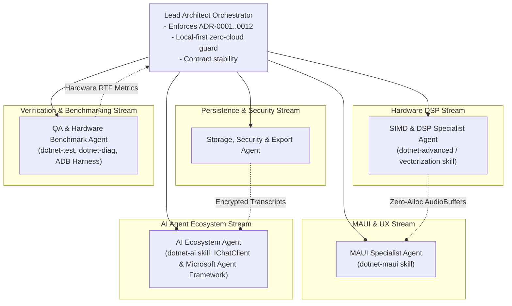

# Scribir: Multi-Agent Implementation Orchestration Plan

**Solution:** [Scriber.slnx](file:///m:/Agentic/Projects/Scribir/Scriber.slnx)  
**Target Runtimes:** `.NET 10.0` / `.NET 9.0` (`net10.0-windows10.0.19041.0`, `net10.0-android`)  
**Authority:** [ADR-0001 through ADR-0012](file:///m:/Agentic/Projects/Scribir/Agent-docs/adr)  
**Reference Skills:** [dotnet/skills](https://github.com/dotnet/skills) (`dotnet-maui`, `dotnet-ai`, `dotnet-advanced` / Vectorization)  
**Updated:** October 26, 2026

---

## 1. Executive Summary & Codebase Reality

Following an exhaustive audit of the entire solution, all 12 Architecture Decision Records ([`Agent-docs/adr/`](file:///m:/Agentic/Projects/Scribir/Agent-docs/adr)) and 43 tracked roadmap tasks across 8 workstreams were verified against the working tree:

* **Task Status:** **43 Total Tasks**
  * **36 Done** (83.7%)
  * **2 Blocked** (4.7% — `PH0-SPIKE-003` Persian validation & `PH0-SPIKE-004` Android hardware benchmark)
  * **5 Not Started** (11.6% — `PH1-STORE-003` SQLCipher, `PH1-EXPORT-003` DOCX/PDF, `PH1-UI-004` SkiaSharp scrubber, `PH1-UI-006` RTL layout pass, `PH1-MODEL-003` first-run benchmark)
* **Test Health:** 149 tests across 9 test suites passing 100% green. The `Progress<T>` threadpool race condition in `TranscriptionPipelineTests.cs` has been eliminated with `SynchronousProgress<T>`.
* **ASR Realities:** Dual-backend architecture is fully operational:
  * `SherpaWhisperAsrBackend` (ONNX Runtime, INT8 multilingual Whisper)
  * `LlamaCppAsrBackend` (Whisper.net / llama.cpp GGUF streaming)
* **AI Providers:** Both BYOK OpenAI-compatible HTTP endpoints (`OpenAiCompatibleProvider`) and on-device GGUF LLMs (`LlamaCppCompletionProvider`) are implemented.
* **Model Catalog:** [`models/catalog.json`](file:///m:/Agentic/Projects/Scribir/models/catalog.json) contains 8 verified model manifests covering low, medium, and high device tiers.

---

## 2. Multi-Agent Implementation Architecture

### Specialized Subagent Roster & Skill Bindings

| Subagent Role | Skill Matrix / Toolchain | Primary Objectives & Backlog Deliverables |
| :--- | :--- | :--- |
| **Lead Orchestrator** | Architecture Guardianship | ADR-0001..0012 compliance; offline-only zero-telemetry guarantee; breaking change prevention. |
| **MAUI & UX Specialist** | `plugins/dotnet-maui` • `maui-collectionview` • `maui-data-binding` • `maui-theming` • `maui-safe-area` | • **`PH1-UI-004`**: Install `SkiaSharp.Views.Maui.Controls` and build `SKCanvasView` windowed waveform scrubber. • **`PH1-UI-006`**: Persian RTL pass with bundled Vazirmatn font, RTL alignment, and Persian numeral localization. |
| **SIMD & DSP Specialist** | `plugins/dotnet-advanced/skills/vectorization` • `Vector128<T>` / `Vector256<T>` • `TensorPrimitives` • Zero-alloc spans | • Accelerate [`WavHelper.Pcm16ToFloat`](file:///m:/Agentic/Projects/Scribir/src/Scriber.Core/Audio/WavHelper.cs#L176) using `MemoryMarshal.Cast<byte, short>` and SIMD widening. • Accelerate [`WavHelper.CalculateRmsLevel`](file:///m:/Agentic/Projects/Scribir/src/Scriber.Core/Audio/WavHelper.cs#L128) via SIMD sum-of-squares. • Replace `List<float>` in `LiveTranscriptionSession` with an `ArrayPool<float>` ring buffer. |
| **Storage & Security** | SQLite, FTS5, SQLCipher, OpenXML, QuestPDF | • **`PH1-EXPORT-003`**: Implement `DocxExporter` (OpenXml) and `PdfExporter` (QuestPDF with HarfBuzz RTL text shaping). • **`PH1-STORE-003`**: Integrate `SQLitePCLRaw.bundle_e_sqlcipher` for database-at-rest encryption. • Resolve `GHSA-2m69-gcr7-jv3q` advisory. |
| **AI Ecosystem & Multi-Agent** | `plugins/dotnet-ai` • `Microsoft.Extensions.AI` • `Microsoft.Agents.AI` • `MEVD` vector search | • Refactor `Scriber.Providers` around `IChatClient`. • Extend `Scriber.Mcp` with `get_transcript_summary` and `search_by_voiceprint`. • Reference multi-agent synthesis workflows. |
| **QA & Hardware Lab** | `plugins/dotnet-test`, `plugins/dotnet-diag`, ADB | • Maintain 100% test determinism. • **`PH1-MODEL-003`**: In-app device benchmark harness. • **`PH0-SPIKE-004`**: Physical device benchmarking on connected Redmi Note 11 (Snapdragon 680). |

---

## 3. Four Sequential Implementation Goals (`/plan /boost /goal`)

### Goal 1: Complete Phase 1 MVP Core Capabilities (Priority: High)
* **Scope:** Close all remaining Phase 1 deliverables to achieve 100% Phase 1 completion.
* **Sprint Backlog:**
  1. [x] Eliminate `TranscriptionPipelineTests.cs` race condition (Synchronous progress collector).
  2. Implement `PH1-EXPORT-003`: `DocxExporter` (OpenXml) and `PdfExporter` (QuestPDF + HarfBuzz RTL text shaping).
  3. Implement `PH1-UI-004`: `SkiaSharp.Views.Maui.Controls` package + windowed `SKCanvasView` playback scrubber.
  4. Implement `PH1-STORE-003`: SQLCipher encryption toggle in `SqliteTranscriptRepository`.
* **Acceptance Criteria:** All Phase 1 tasks marked `Done`; zero NuGet vulnerability warnings; 100% test green.

### Goal 2: High-Performance SIMD Vectorization & Streaming Audio DSP (Priority: High)
* **Scope:** Zero-allocation audio paths and vector acceleration based on `dotnet-advanced` skill rules.
* **Sprint Backlog:**
  1. Vectorize `WavHelper.Pcm16ToFloat` with span casting and `Vector128<float>`.
  2. Vectorize `WavHelper.CalculateRmsLevel` for real-time VU meter updates.
  3. Replace dynamic allocations in `LiveTranscriptionSession` with an `ArrayPool<float>` ring buffer.
* **Acceptance Criteria:** Verified >2x speedup on audio format conversions; 0 bytes GC allocated in 16kHz capture loop.

### Goal 3: Next-Gen .NET AI & Multi-Agent MCP Ecosystem (Priority: Medium)
* **Scope:** Elevate Scribir into a standard AI agent hub using Microsoft Agent Framework.
* **Sprint Backlog:**
  1. Wrap `OpenAiCompatibleProvider` and `LlamaCppCompletionProvider` with `Microsoft.Extensions.AI.IChatClient`.
  2. Extend `Scriber.Mcp` with agent tools: `get_transcript_summary` and `search_by_voiceprint`.
  3. Construct reference multi-agent research workflow on `Microsoft.Agents.AI`.
* **Acceptance Criteria:** Full JSON-RPC 2.0 stdio compliance verified against Claude Desktop, Hermes Agent, and Copilot SDK.

### Goal 4: Mobile Android Hardware Benchmarking & Onboarding (Priority: Medium)
* **Scope:** Complete `PH0-SPIKE-004` and `PH1-MODEL-003` on physical hardware.
* **Sprint Backlog:**
  1. Run automated ADB benchmark harness on connected Xiaomi Redmi Note 11 (Android 13, Snapdragon 680).
  2. Capture wall-clock RTF and peak RSS memory across model variants.
  3. Populate [`Agent-docs/product/03-model-device-matrix-template.md`](file:///m:/Agentic/Projects/Scribir/Agent-docs/product/03-model-device-matrix-template.md).
  4. Implement `PH1-MODEL-003` first-run benchmark harness saving device-tier defaults.
* **Acceptance Criteria:** Documented physical device metrics and automatic device-tier onboarding.
