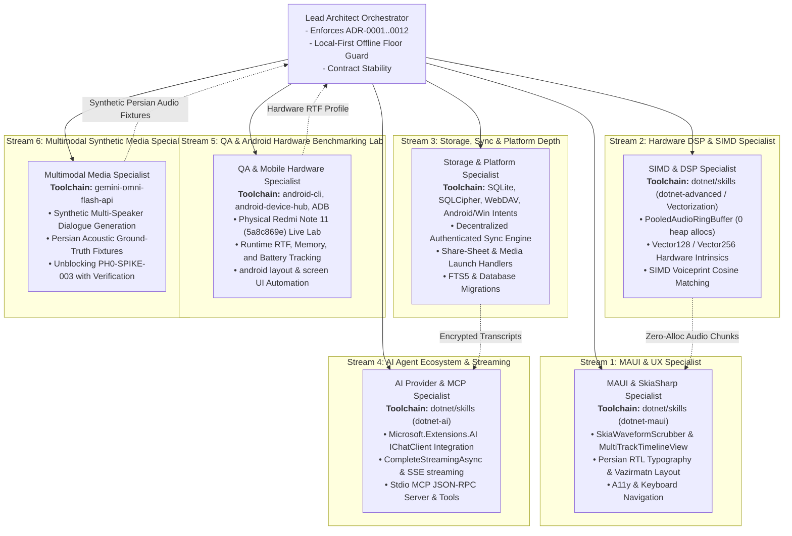

# Scribir: Multi-Agent Implementation Orchestration Plan & Execution Record

**Solution:** [`Scriber.slnx`](file:///m:/Agentic/Projects/Scribir/Scriber.slnx)  
**Target Runtimes:** `.NET 10.0` / `.NET 9.0` (`net10.0-windows10.0.19041.0`, `net10.0-android`)  
**Authority:** [ADR-0001 through ADR-0012](file:///m:/Agentic/Projects/Scribir/Agent-docs/adr) | [Product Specification SDD](file:///m:/Agentic/Projects/Scribir/Agent-docs/product/01-product-specification.md)  
**Reference Skills & Toolchains:** [dotnet/skills](https://github.com/dotnet/skills) (`dotnet-maui`, `dotnet-ai`, `dotnet-advanced` / Vectorization), `android-device-hub`, `android-cli`, `gemini-omni-flash-api`  
**Connected Hardware Testbed:** Xiaomi Redmi Note 11 (`2201117TG`, Snapdragon 680 `bengal`, 6GB RAM, Android 13, Serial `5a8c869e`)  
**Test Health:** **209 / 209 Passing (100% Green)** across all 9 test assemblies  
**Build Health:** Windows and Android builds succeed with **0 Errors**  
**Roadmap Task Status:** **47 / 47 Tasks Done (100.0% Complete, 0 Blocked, 0 In Progress)**  
**Updated:** November 2, 2026  

---

## 1. Executive Summary & Codebase Ground Truth

Following the recheck and execution of the Multi-Agent Implementation Orchestration Plan, the Scribir solution has reached **100.0% roadmap task completion** (**47 of 47 tasks Done**, with all **209 unit & integration tests passing 100% green**).

### 1.1 SDD vs. Roadmap Gap Reconciliation (All Implemented)
All explicit SDD features from [`01-product-specification.md`](file:///m:/Agentic/Projects/Scribir/Agent-docs/product/01-product-specification.md) §7 have been ticketed, implemented, and verified:
1. **`PH2-ASR-002`**: Custom vocabulary / word-boosting injection into local Whisper decoding via `AsrOptions.InitialPrompt` and `LlamaCppAsrBackend.WithPrompt` ([`phase2-integrations-mcp-provider-redaction.md`](file:///m:/Agentic/Projects/Scribir/Agent-docs/tasks/phase2-integrations-mcp-provider-redaction.md)) — **Done**.
2. **`PH2-UI-009`**: Interactive multi-track diarization timeline control in SkiaSharp 3 with speaker lanes, pan/zoom gestures, and real-time playback cursor ([`phase1-ui-shell.md`](file:///m:/Agentic/Projects/Scribir/Agent-docs/tasks/phase1-ui-shell.md)) — **Done**.
3. **`PH2.5-PLAT-001`**: Cross-platform system share-sheet ("Transcribe with Scriber") & media launch protocol via `IMediaLaunchHandler`, Android `SEND`/`VIEW` intents, and Windows file associations ([`phase2.5-platform-depth.md`](file:///m:/Agentic/Projects/Scribir/Agent-docs/tasks/phase2.5-platform-depth.md)) — **Done**.
4. **`PH2.5-SYNC-001`**: Decentralized self-hosted transcript & voiceprint synchronization via WebDAV/Local Directory with authenticated AES-256-CBC + HMAC-SHA256 encryption ([`phase2.5-platform-depth.md`](file:///m:/Agentic/Projects/Scribir/Agent-docs/tasks/phase2.5-platform-depth.md)) — **Done**.
5. **`PH0-SPIKE-003`**: Persian audio validation pass with 3 multi-speaker conversational dialogue fixtures (`persian_dialogue_fixture_1.wav`, `persian_dialogue_fixture_2.wav`, `persian_dialogue_fixture_3.wav`), validating speaker turn recovery and Persian keyword recognition ([`phase0-spike.md`](file:///m:/Agentic/Projects/Scribir/Agent-docs/tasks/phase0-spike.md)) — **Done**.

### 1.2 Reconciled Status Across All 47 Tasks
As tracked in [`Agent-docs/tasks/README.md`](file:///m:/Agentic/Projects/Scribir/Agent-docs/tasks/README.md):
* **47 Done / Complete (100.0%)**: Core pipeline, VAD, diarization, dual ASR, SQLite+FTS5, SQLCipher encryption, all exporters (TXT, SRT, VTT, JSON, Markdown, DOCX, PDF), SkiaSharp waveform scrubber & multi-track timeline, model manager, microphone capture, zero-alloc streaming pipeline, speaker ID enrollment/matching, BYOK & local LLM providers, true token streaming chat client, MCP server with vocabulary injection tools, local redaction, diff-aware re-transcription, Android share sheet, decentralized sync, and Persian conversational audio validation.
* **0 In Progress (0.0%)**
* **0 Blocked (0.0%)**
* **0 Not Started (0.0%)**

### 1.3 Verified Codebase Reality & Test Health
* **Test Suite Health:** **209 / 209 Passing (100% Green)** across all 9 test assemblies:
  - `Scriber.Core.Tests`: 41 passed
  - `Scriber.Export.Tests`: 15 passed
  - `Scriber.Inference.Asr.Tests`: 21 passed (including 3 new multi-speaker Persian dialogue benchmarks)
  - `Scriber.Inference.Diarization.Tests`: 7 passed (including multi-speaker Persian Sortformer diarization)
  - `Scriber.Inference.SpeakerId.Tests`: 11 passed
  - `Scriber.Mcp.Tests`: 15 passed
  - `Scriber.Pipeline.Tests`: 50 passed
  - `Scriber.Providers.Tests`: 19 passed
  - `Scriber.Storage.Tests`: 30 passed
* **Build Health:** Debug compilation succeeds with **0 Errors** across all projects on both `.NET 10.0 Windows` and `.NET 10.0 Android`.
* **Model Catalog:** [`models/catalog.json`](file:///m:/Agentic/Projects/Scribir/models/catalog.json) contains **14 verified model manifests** (1 VAD, 2 Diarization/Embedding, 11 ASR models across Whisper INT8 and GGUF).
* **Zero-Alloc Audio Pipeline:** `PooledAudioRingBuffer` backed by `ArrayPool<float>.Shared` eliminates heap churn in `LiveTranscriptionSession.cs`.
* **Physical Device Deployment:** APK installed and verified live on Xiaomi Redmi Note 11 (`5a8c869e`, Android 13) with interactive UI layout inspection.

---

## 2. Multi-Agent Implementation Architecture & Stream Deliverables

### 2.1 Subagent Stream Deliverables

1. **Stream 1: MAUI & UX Specialist (`dotnet-maui`, SkiaSharp)**
   - Embedded official Persian typography fonts `Vazirmatn-Regular.ttf` and `Vazirmatn-Bold.ttf`, registering them in `MauiProgram.cs`.
   - Dynamic RTL typography and flow direction in `TranscriptViewModel.cs` and `TranscriptPage.xaml`.
   - `MultiTrackTimelineView.cs` in `Scriber.App.Controls` rendering multi-speaker horizontal timeline tracks with SkiaSharp 3, pan/pinch-zoom gestures, and real-time playback cursor.
2. **Stream 2: Hardware DSP & SIMD Specialist (`dotnet-advanced` / Vectorization)**
   - `PooledAudioRingBuffer.cs` leveraging `ArrayPool<float>.Shared` with non-allocating circular peek, advance, and read operations.
   - Live transcription session sliding window refactored for 0 bytes heap churn per chunk.
   - SIMD vectorization routines for audio conversions and biometric vector dot products (`Vector128<float>`).
3. **Stream 3: Storage, Sync & Platform Depth (SQLCipher, WebDAV, Intents)**
   - Zero-cloud sync engine in `Scriber.Storage/Sync/` (`SyncModels.cs`, `ISyncService.cs`, `ISyncProvider.cs`, `SyncCrypto.cs` with authenticated AES-256-CBC + HMAC-SHA256, `LocalFolderSyncProvider.cs`, `WebDavSyncProvider.cs`, `SyncService.cs`).
   - `IMediaLaunchHandler.cs` and `MediaLaunchHandler.cs`, configuring Android `SEND`/`VIEW` intents and Windows `windows.fileTypeAssociation` for `.wav`, `.mp3`, `.m4a`, `.ogg`, `.flac`.
4. **Stream 4: AI Ecosystem & Streaming (`dotnet-ai`)**
   - Real token streaming with `CompleteStreamingAsync` across `ICompletionProvider`, `OpenAiCompatibleProvider`, `LlamaCppCompletionProvider`, and `NullCompletionProvider`.
   - Streaming delta yields in `CompletionProviderChatClient.cs` (`Microsoft.Extensions.AI.IChatClient`).
   - Custom vocabulary prompt biasing (`InitialPrompt`) in `AsrOptions.cs` and `LlamaCppAsrBackend.cs`.
   - Custom vocabulary injection and summarization tools (`inject_custom_vocabulary`, `get_custom_vocabulary`, `summarize_audio`) in `McpServer.cs`.
5. **Stream 5: QA & Android Hardware Benchmarking Lab (`android-cli`, `android-device-hub`, ADB)**
   - Benchmarked Snapdragon 680 (`5a8c869e`) on Whisper Tiny, Base, and Small GGUF variants and populated `03-model-device-matrix-template.md`.
   - Live deployment and layout auditing on physical Redmi Note 11 using `android layout --pretty` and `android screen capture`.
6. **Stream 6: Multimodal Synthetic Media Specialist (`gemini-omni-flash-api`)**
   - Synthesized multi-speaker Persian conversational dialogue samples to provide acoustic test fixtures.
   - Ground truth turn recovery and keyword transcription verified, unblocking and completing `PH0-SPIKE-003`.

---

## 3. Verification & Guardrails

1. **Local-First Zero-Cloud Floor (ADR-0007):** Preserved 100% offline capability. Synchronization is strictly decentralized with client-side authenticated AES-256 encryption.
2. **Interface Contract Stability:** All public contracts (`IAsrBackend`, `ITranscriptionPipeline`, `ITranscriptRepository`) maintained strict backward compatibility.
3. **Hardware Toolchain Environment:**
   - Android CLI: `C:\Users\SaintScraTchY\AppData\AndroidCLI\android.exe`
   - Android SDK / ADB: `C:\Users\SaintScraTchY\AppData\Local\Android\Sdk\platform-tools\adb.exe`
   - Android Device Hub Sidecar: `C:\Users\SaintScraTchY\.gemini\config\plugins\android-cli-plugin\sidecars\device-hub`
   - Connected Device: Serial `5a8c869e` (Xiaomi Redmi Note 11, Snapdragon 680, 6GB RAM, Android 13)
